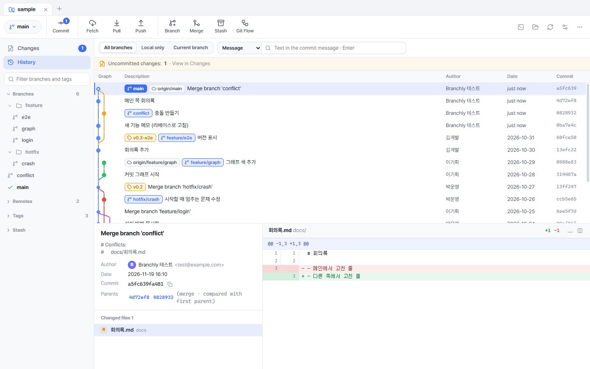

# Branchly

[한국어](README.md) · **English**

**A Git client for Windows.** Create branches, merge, commit and push with clicks while looking at the commit graph.
No commands to memorize, and merge conflicts can be resolved right on screen.



## Download

### [⬇ Get the latest version](https://github.com/winjun0221/branchly/releases/latest)

| File | |
|---|---|
| `Branchly-Setup-<version>.exe` | **Installer (recommended)** · updates itself when a new version is out |
| `Branchly-<version>-portable.exe` | Runs without installing · no auto-update |

**Requirements:** Windows 10 / 11 (64-bit), [Git for Windows](https://git-scm.com/download/win)
If Git is missing, Branchly tells you on first launch.

## Install

1. Run `Branchly-Setup-<version>.exe`.
2. If **"Windows protected your PC"** appears, click **More info → Run anyway** (the app isn't code-signed yet).
3. Pick a folder and install. No administrator rights needed.
4. Start **Branchly** from the desktop or the Start menu.

- **Language:** follows Windows (Korean or English). Change it in Settings → General → Language.
- **Updates:** new versions download in the background; click "Restart to install" at the top right, or they install the next time you quit.
- **Uninstall:** Windows Settings → Apps → Branchly → Uninstall.

## What it does

- **History:** commit graph; search by message, author, file or code; compare two commits; file history; blame
- **Branches:** create, switch, rename, delete, merge, rebase, interactive rebase, cherry-pick, revert, reset, tags
- **Changes:** stage, unstage or discard whole files, hunks or single lines; add to .gitignore; stash
- **Conflicts:** pick ours/theirs or edit, then continue, skip or abort
- **Remotes:** fetch, pull and push with options; manage remotes; open a pull request page on GitHub, GitLab or Bitbucket
- **Also:** repositories in tabs, clone and init, Git Flow (feature/release/hotfix), submodules, Git LFS, SSH key generation, light/dark theme, open a terminal or Explorer in one click

## FAQ

**Does my code get sent anywhere?**
No. Branchly only runs the Git installed on your PC. It uses the network only for the fetch/pull/push you start (to your own remotes) and to check for new versions (this repository's releases).

**Shortcuts**

| Keys | Action |
|---|---|
| Ctrl + Enter | Commit |
| Ctrl + T / Ctrl + W / Ctrl + Tab | New tab / close tab / next tab |
| F5 | Refresh |
| Ctrl + = / Ctrl + − / Ctrl + 0 | Zoom in / out / auto |

**Found a problem?**
Please open an [issue](https://github.com/winjun0221/branchly/issues) and tell us what you were doing and what message appeared.

## Building from source

Requires Node.js 22+ and Git for Windows.

```bash
npm install
npm start        # build and run
npm test         # unit and Git integration tests
npm run e2e      # click-through test of the real app
npm run dist     # installer and portable exe in release/
```

## License

[MIT](LICENSE) · Third-party licenses: [THIRD_PARTY_NOTICES.md](THIRD_PARTY_NOTICES.md)
