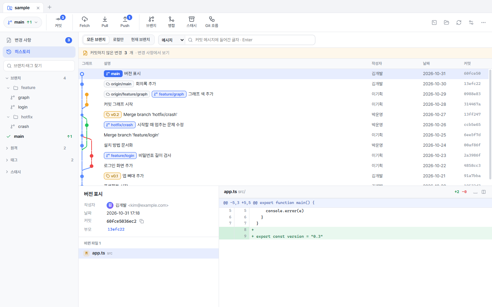
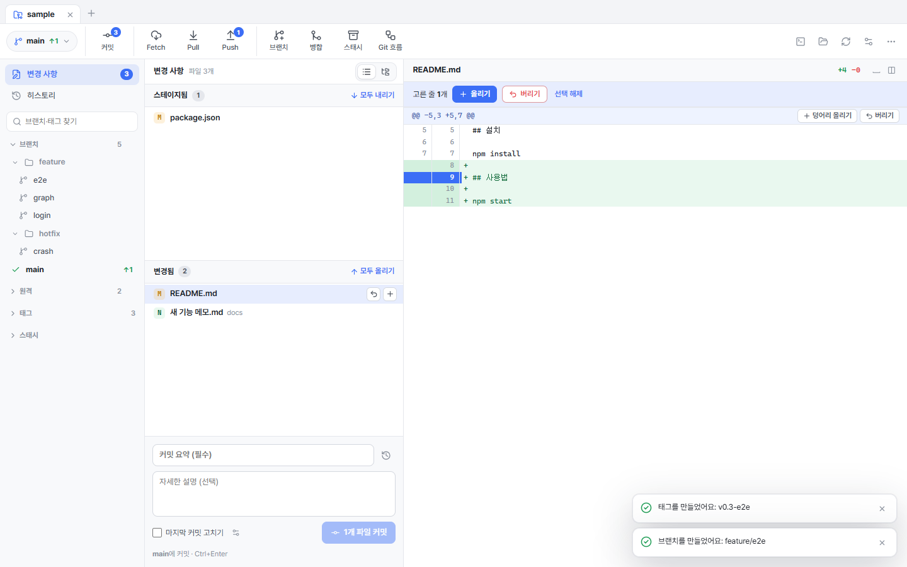
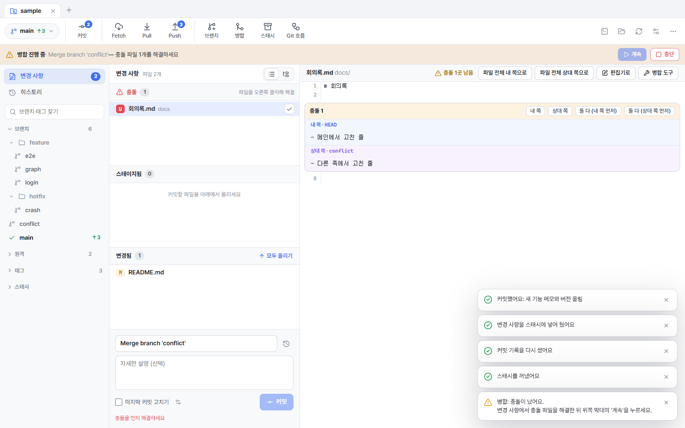
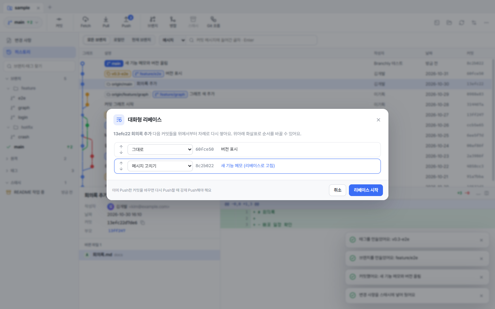
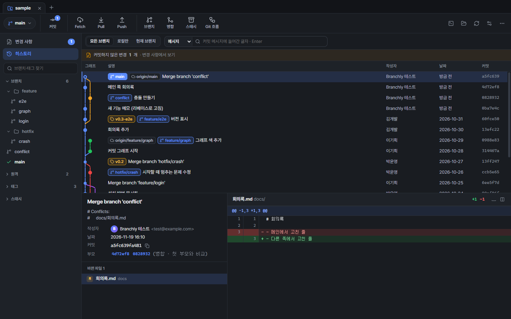

# Branchly

**한국어** · [English](README.en.md) · [](https://github.com/winjun0221/branchly/actions/workflows/ci.yml)

**윈도우용 Git 관리 프로그램.** 커밋 그래프를 보면서 브랜치 만들기·병합·커밋·올리기를 클릭으로 할 수 있어요.
명령어를 몰라도 되고, 충돌이 나도 화면에서 바로 풀 수 있어요.



## 내려받기

### [⬇ 최신 버전 받기](https://github.com/winjun0221/branchly/releases/latest)

| 파일 | 설명 |
|---|---|
| `Branchly-Setup-<버전>.exe` | **설치 파일 (권장)** · 새 버전이 나오면 자동으로 업데이트돼요 |
| `Branchly-<버전>-portable.exe` | 설치 없이 바로 실행 · 자동 업데이트는 안 돼요 |

**필요한 것:** Windows 10 / 11 (64비트), [Git for Windows](https://git-scm.com/download/win)
Git이 없으면 처음 켤 때 설치 안내가 떠요.

## 설치

1. `Branchly-Setup-<버전>.exe`를 실행해요.
2. **"Windows의 PC 보호"** 창이 뜨면 **추가 정보 → 실행**을 눌러요. (아직 코드 서명 전이라 뜨는 창이에요)
3. 설치 위치를 고르고 설치해요. 관리자 권한은 필요 없어요.
4. 바탕 화면이나 시작 메뉴의 **Branchly**로 켜요.

- **언어:** Windows 언어를 따라가요(한국어·영어). 설정 → 일반 → 언어에서 바꿀 수 있어요.
- **업데이트:** 켜 둔 동안 새 버전을 알아서 받아 두고, 오른쪽 위에 "다시 시작해서 설치"가 떠요. 안 눌러도 다음에 끌 때 설치돼요.
- **삭제:** Windows 설정 → 앱 → Branchly → 제거.

## 할 수 있는 일

| | |
|---|---|
|  |  |
| **줄 단위로 골라서 커밋** — 파일 통째로가 아니라 필요한 줄만 올리고, 필요 없는 변경은 버려요 | **충돌 해결** — 충돌 부분마다 내 쪽·상대 쪽·둘 다 골라서 풀고, 계속·건너뛰기·중단 |
|  |  |
| **커밋 정리** — 순서 바꾸기·메시지 고치기·합치기·버리기를 목록에서 | **밝은·어두운 모드**, 창을 키우면 화면도 알맞게 커져요 |

- **히스토리:** 커밋 그래프, 메시지·작성자·파일·코드 내용으로 찾기, 두 커밋 비교, 파일 기록, 줄별 작성자(blame)
- **브랜치:** 만들기·바꾸기·이름 바꾸기·지우기, 병합, 리베이스, 체리픽, 되돌리기(revert), 리셋, 태그
- **변경 사항:** 파일·덩어리·줄 단위 올리기/내리기/버리기, 무시할 파일 추가, 스태시(잠시 넣어 두기)
- **원격:** Fetch·Pull·Push(옵션 선택), 원격 저장소 관리, GitHub·GitLab·Bitbucket 풀 리퀘스트 페이지 열기
- **그 밖에:** 여러 저장소를 탭으로, 복제·새 저장소 만들기, Git 흐름(feature/release/hotfix), 서브모듈, Git LFS, SSH 키 만들기, 터미널·탐색기 바로 열기

## 자주 묻는 것

**내 코드가 다른 곳으로 보내지나요?**
아니요. Branchly는 내 PC에 설치된 Git을 실행할 뿐이에요. 인터넷은 내가 누른 가져오기·올리기(내 원격 저장소)와 새 버전 확인(이 페이지의 릴리스)에만 써요.

**단축키**

| 키 | 동작 |
|---|---|
| Ctrl + Enter | 커밋 |
| Ctrl + T / Ctrl + W / Ctrl + Tab | 새 탭 / 탭 닫기 / 다음 탭 |
| F5 | 새로고침 |
| Ctrl + = / Ctrl + − / Ctrl + 0 | 화면 크게 / 작게 / 자동 |

**문제가 생겼어요**
이 저장소의 [Issues](https://github.com/winjun0221/branchly/issues)에 남겨 주세요. 어떤 작업을 하다가 어떤 메시지가 떴는지 적어 주시면 좋아요.

## 소스에서 빌드하기

Node.js 22 이상과 Git for Windows가 필요해요.

```bash
npm install
npm start        # 빌드하고 실행
npm test         # 단위·실제 git 테스트
npm run e2e      # 실제 앱을 띄워 눌러 보는 테스트
npm run dist     # release/에 설치 파일·포터블 exe
```

## 라이선스

[MIT](LICENSE) · 함께 들어간 외부 소프트웨어: [THIRD_PARTY_NOTICES.md](THIRD_PARTY_NOTICES.md)
